# cmos_vref — default

**Variation ID:** `cmos_vref-default-5f7415`  
**Exported:** 2026-10-23T07:06:42  
**Layout:** published  
**LVS:** mismatch

CMOS vref generator that compensates the FET VTH CTAT behaviour with a PTAT current generated with a self biased voltage following current mirror.

**References:**
- OLIVEIRA, Arthur Campos de. Temperature compensated subthreshold CMOS voltage references for ultra low power applications. 2017.
- CAMACHO-GALEANO, Edgar Mauricio; GALUP-MONTORO, Carlos; SCHNEIDER, Márcio Cherem. A 2-nW 1.1-V self-biased current reference in CMOS technology. IEEE Transactions on Circuits and Systems II: Express Briefs, v. 52, n. 2, p. 61-65, 2005.

## Schematic

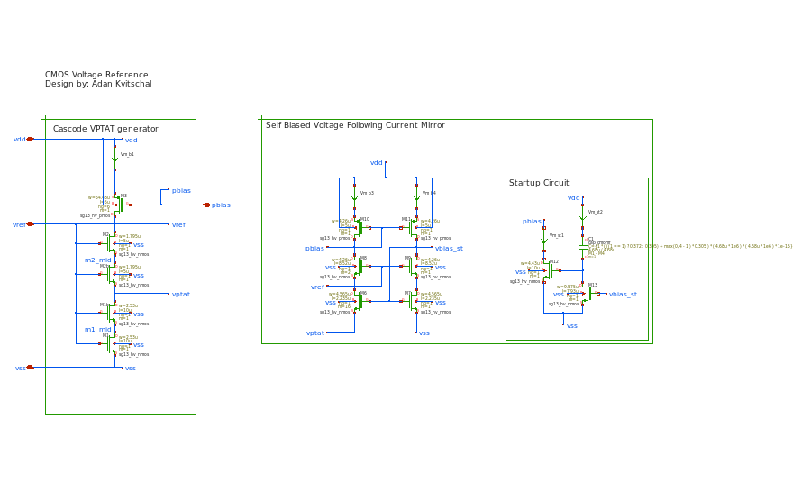

## Layout

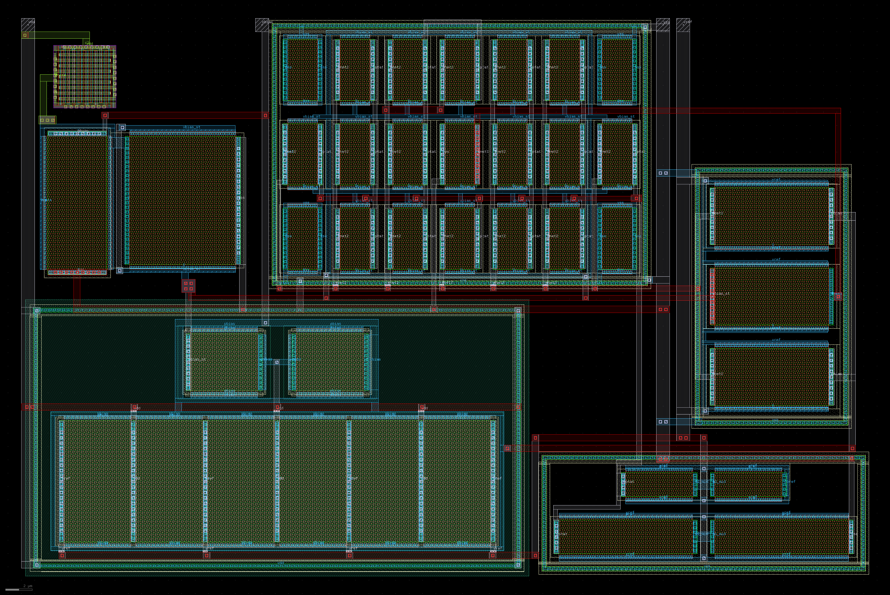

- Magic cells (what a designer edits): [`layout/cmos_vref/cmos_vref-default-5f7415/`](../../../layout/cmos_vref/cmos_vref-default-5f7415/)
- GDS of that cell: [`release/layout/cmos_vref/cmos_vref.gds`](../../layout/cmos_vref/cmos_vref.gds)

## Parameters

| Parameter | Value | Description |
|---|---|---|
| m1_length | 20u | TOTAL effective channel length of the lower cascode vptat generator transistor. Drawn as a series stack of two M1/M1b devices (gates tied, internal net m1_mid), each with l = m1_length/2 (formula m1_seglen), so each one stays inside the PSP103 model's L <= 10u range (min 0.45u each -> total >= 0.9u). Not electrically identical to one long device (~1% on Vref: body effect at the internal node), so it is simulated as drawn. LVS has no MOS series combiner, hence the stack is explicit in the schematic. |
| m1_width | 2.53u | Channel Width of the lower cascode vptat generator transistor |
| m2_length | 10u | TOTAL effective channel length of the upper cascode vptat generator transistor. Drawn as a series stack of two M2/M2b devices (gates tied, internal net m2_mid), each with l = m2_length/2 (formula m2_seglen), so each one stays inside the PSP103 model's L <= 10u range (min 0.45u each -> total >= 0.9u). Not electrically identical to one long device (~1% on Vref: body effect at the internal node), so it is simulated as drawn. LVS has no MOS series combiner, hence the stack is explicit in the schematic. |
| m2_width | 1.795u | Channel Width of the upper cascode vptat generator transistor |
| pbias_length | 5u | Channel Length of the PMOS bias transistors |
| m3_width | 54.48u | Channel Width of the bias transistor on the vptat generator branch |
| m6m7_length | 2.235u | Channel Length of the M6/M7 nmos current mirror pair in the self-biased voltage following current mirror (sbvfcm) |
| m6m7_width_base | 4.565u | Shared unit-cell channel width for the M6/M7 nmos current-mirror pair (sbvfcm) -- actual per-leg width is this * the leg's own integer factor (m6_factor/m7_factor), computed in Python before schematic substitution (never a formula in the netlist). See this file's derived_parameters.width_groups. |
| m6_factor | 16 | Integer multiple of m6m7_width_base giving M6's actual channel width (diode-connected mirror leg) -- also the intended unit-cell count for future common-centroid layout. |
| m7_factor | 1 | Integer multiple of m6m7_width_base giving M7's actual channel width (mirrored leg) -- together with m6_factor this sets the sbvfcm's current-mirror ratio, a real circuit design freedom, not just a matching artifact. |
| m8m9_length | 8.52u | Channel Length of the M8/M9 nmos cascode pair stacked above M6/M7 in the sbvfcm |
| m8m9_width_base | 4.26u | Shared unit-cell channel width for the M8/M9 nmos cascode pair stacked above M6/M7 -- actual per-leg width is this * the leg's own integer factor (m8_factor/m9_factor). See this file's derived_parameters.width_groups. |
| m8_factor | 2 | Integer multiple of m8m9_width_base giving M8's actual channel width. Locked to 1 for now (min=max=1) -- preserves today's exact M8=M9 invariant; widen only as a deliberate later decision once a reason to ratio the cascodes differently is identified. |
| m9_factor | 1 | Integer multiple of m8m9_width_base giving M9's actual channel width. Locked to 1 for now, see m8_factor. |
| m10m11_width | 4.26u | Channel Width shared by M10 (diode) and M11 (mirror), the pbias_mirror pair biasing the sbvfcm -- a single parameter, not two, so layout.groups.pbias_mirror's pair (M10/M11 must be built identically) is satisfied by construction instead of by chance (was m10_width/m11_width, two independent parameters that could -- and, across most of the existing population, did -- drift apart). Range is the intersection of the former two (min 0.30u shared already, max 10u from the tighter of the two, m11_width's own former max). |
| m12_length | 10u | Channel Length of transistor M12 (startup circuit transistor) |
| m12_width | 4.43u | Channel Width of transistor M12 (startup circuit transistor) |
| m13_length | 7.93u | Channel Length of transistor M13 (startup circuit transistor) |
| m13_width | 9.575u | Channel Width of transistor M13 (startup circuit transistor) |
| startup_cap_side | 4.68u | Side length of the square MiM startup capacitor C1 (w=l=side) (cap_cmomf, M1-M4: 1.287 fF/um^2; sized to keep the former cap_cmim (1.5 fF/um^2) total capacitance, i.e. side x1.08) |
| startup_cap_mult | 1 | Instance multiplier (m=) of the startup capacitor C1 |
| m1_ng (ƒx) | 1 | M1: number of fingers so each finger is <= w_finger_max wide (w=m1_width is the total width of one instance). |
| m2_ng (ƒx) | 1 | M2: number of fingers so each finger is <= w_finger_max wide (w=m2_width is the total width of one instance). |
| m3_ng (ƒx) | 6 | M3: number of fingers so each finger is <= w_finger_max wide (w=m3_width is the total width of one instance). |
| m6_ng (ƒx) | 1 | M6: number of fingers so each finger is <= w_finger_max wide (w=m6m7_width_base is the total width of one instance). |
| m7_ng (ƒx) | 1 | M7: number of fingers so each finger is <= w_finger_max wide (w=m6m7_width_base is the total width of one instance). |
| m8_ng (ƒx) | 1 | M8: number of fingers so each finger is <= w_finger_max wide (w=m8m9_width_base is the total width of one instance). |
| m9_ng (ƒx) | 1 | M9: number of fingers so each finger is <= w_finger_max wide (w=m8m9_width_base is the total width of one instance). |
| m10_ng (ƒx) | 1 | M10: number of fingers so each finger is <= w_finger_max wide (w=m10m11_width is the total width of one instance). |
| m11_ng (ƒx) | 1 | M11: number of fingers so each finger is <= w_finger_max wide (w=m10m11_width is the total width of one instance). |
| m12_ng (ƒx) | 1 | M12: number of fingers so each finger is <= w_finger_max wide (w=m12_width is the total width of one instance). |
| m13_ng (ƒx) | 1 | M13: number of fingers so each finger is <= w_finger_max wide (w=m13_width is the total width of one instance). |
| m1_seglen (ƒx) | 10u | M1/M1b: length of each of the two series segments (half of m1_length). |
| m2_seglen (ƒx) | 5u | M2/M2b: length of each of the two series segments (half of m2_length). |

## Design profile

Matched profile: **low_power** (7/7 constraints) — FOM: 462K

| Profile | Score | FOM | Description |
|---|---|---|---|
| low_power | 7/7 | 462K | Notably lower current consumption than the spec requires |
| high_performance | 4/7 | 266.3 | Meets temperature coefficient, line/load regulation, startup, and PSRR specs simultaneously |

## Test results

**Post-layout:** this block's layout was re-simulated from its extracted netlist (parasitics: capacitance only (no interconnect resistance)), but no test produced a usable number, so there is no post-layout column below. Tests attempted: `psrr`.
Post-layout run FAILED for `psrr` -- those rows have no post-layout value:

- `psrr`: .subckt cmos_vref's port lists differ between the schematic-derived netlist ['vref', 'vdd', 'vss', 'pbias'] and the extracted one ['vdd', 'pbias', 'vref', 'vss_uq3'] -- not just a reorder, can't safely splice

| Test | Metric | Typical | Min | Max | Mean | Std | Unit | Spec | Pass |
|---|---|---|---|---|---|---|---|---|---|
| area | Estimated layout area | 2020 | 2020 | 2020 |  |  | µm² |  | PASS |
| current_consumption | Vref core current consumption | 0.183 | 0.115 | 0.2672 |  |  | uA |  | PASS |
| line_reg | Line regulation | 0.09502 | 0.06361 | 0.2074 |  |  | % |  | PASS |
| load_reg | Load regulation | 0.1696 | 0.168 | 0.206 |  |  | % |  | PASS |
| noise | Output-referred noise | 11.51 | 10.69 | 12.35 |  |  | nV/sqrt(Hz) | ≤ 7 nV/sqrt(Hz) |  |
| psrr | PSRR @ 1kHz | 55.78 | 55.45 | 55.85 |  |  | dB |  | PASS |
| reference_current | Core reference current (M3 branch) | 158.1 | 99.29 | 230.7 |  |  | nA |  |  |
| startup | Startup overshoot | 185.1 | 174 | 199.5 |  |  | % |  |  |
| startup | Startup settling time | 14.85 | 13.98 | 15.76 |  |  | us |  | PASS |
| startup | Vref peak voltage | 2.274 | 2.23 | 2.331 |  |  | V |  |  |
| temp_sweep | Temperature coefficient (commercial 0-70C) | 54.72 | 49.86 | 59.12 |  |  | ppm/°C |  | PASS |
| temp_sweep | Temperature coefficient (full -40-125C) | 97.7 | 92.82 | 100.3 |  |  | ppm/°C |  |  |
| temp_sweep | Temperature coefficient (industrial -40-85C) | 55.52 | 54.47 | 64.93 |  |  | ppm/°C |  |  |
| temp_sweep | Vref output voltage | 0.7977 | 0.7408 | 0.841 |  |  | V |  |  |
| vref_mismatch | Core reference current (M3 branch) (mismatch) |  | 138.7 | 192.3 | 159.9 | 11.78 | nA |  |  |
| vref_mismatch | Vref output voltage (mismatch) |  | 0.7805 | 0.8248 | 0.799 | 0.009337 | V |  |  |
| vref_stat | Core reference current (M3 branch) (stat) |  | 151.6 | 163.4 | 157.9 | 2.467 | nA |  |  |
| vref_stat | Vref output voltage (stat) |  | 0.7743 | 0.8409 | 0.7979 | 0.01253 | V |  |  |

## Plots

### current_consumption — Vdd1.8

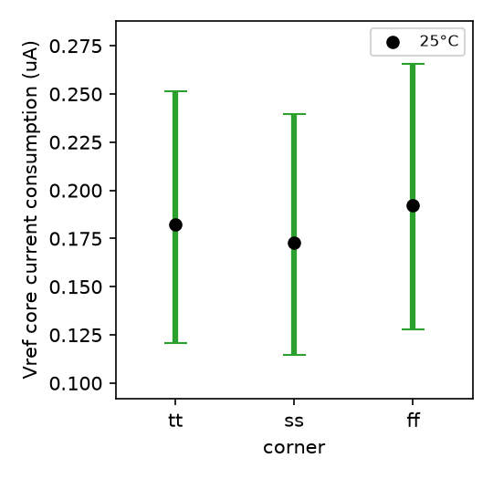

### current_consumption — plot

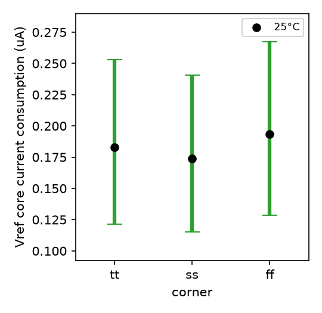

### line_reg — All

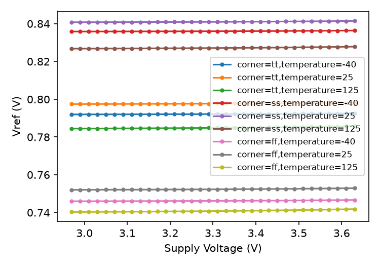

### line_reg — Typical

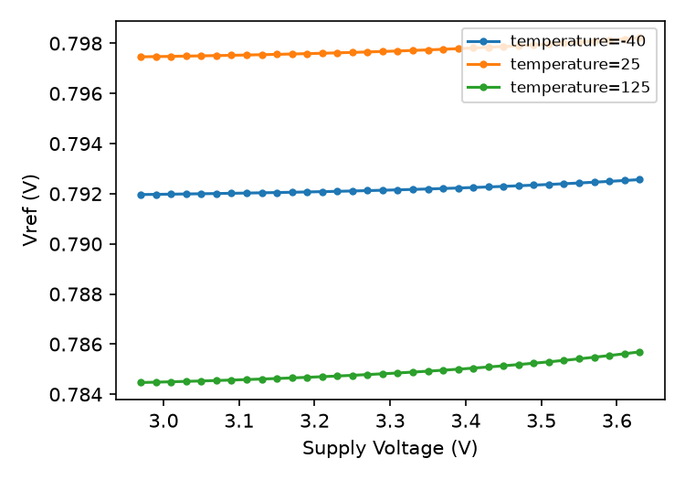

### line_reg — Worst

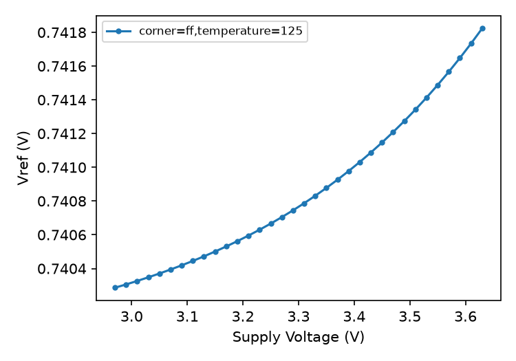

### load_reg — All

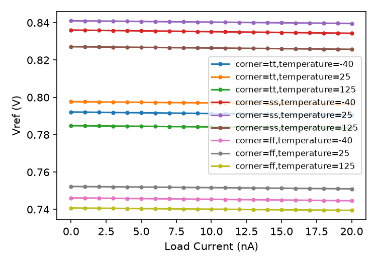

### load_reg — Typical

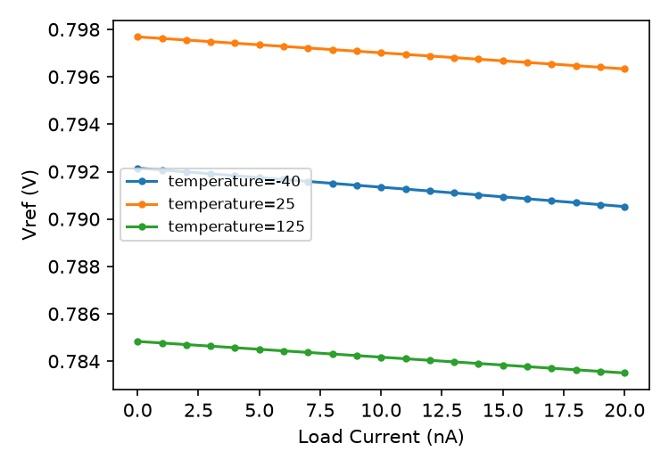

### load_reg — Worst

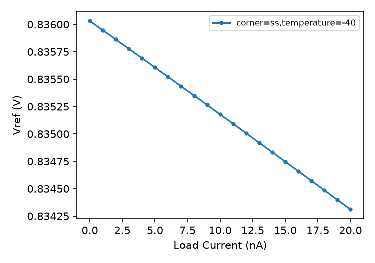

### noise — plot

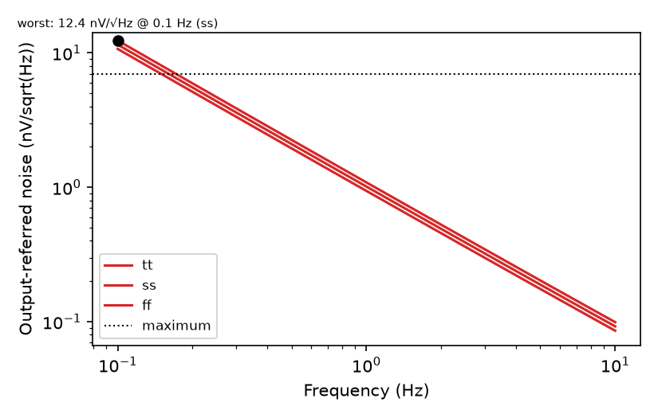

### psrr — plot

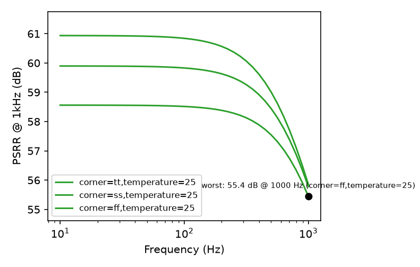

### reference_current — Vdd1.8

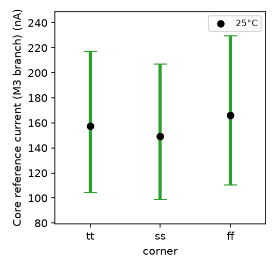

### reference_current — plot

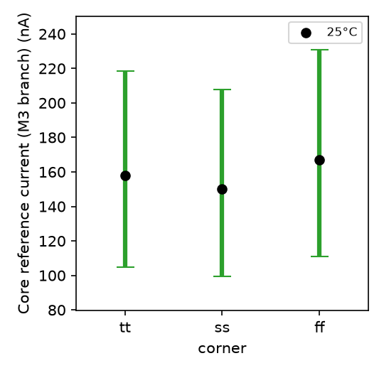

### startup — Vdd1.8

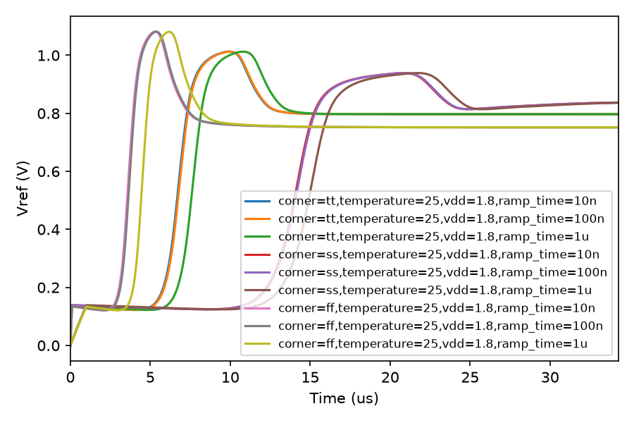

### startup — plot

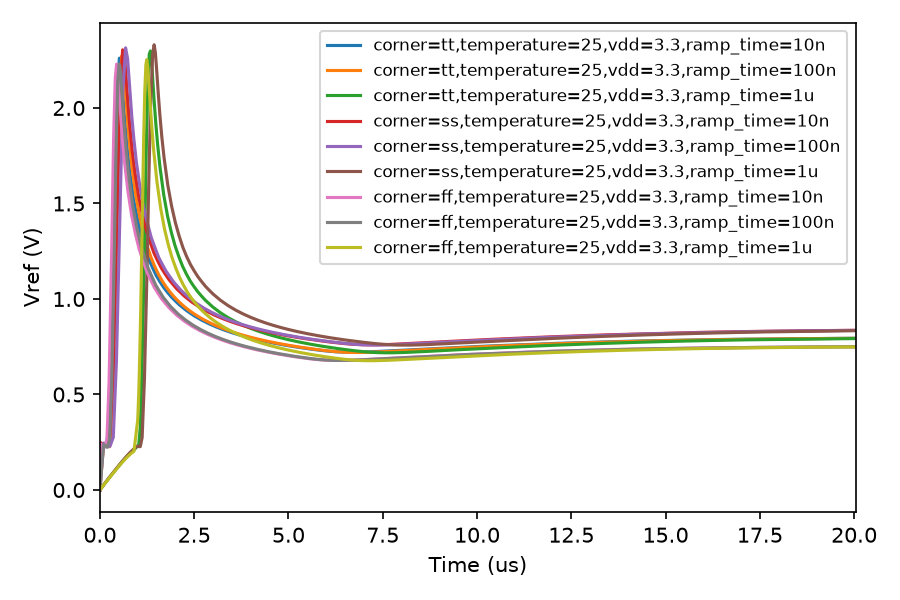

### temp_sweep — All

### temp_sweep — Typical

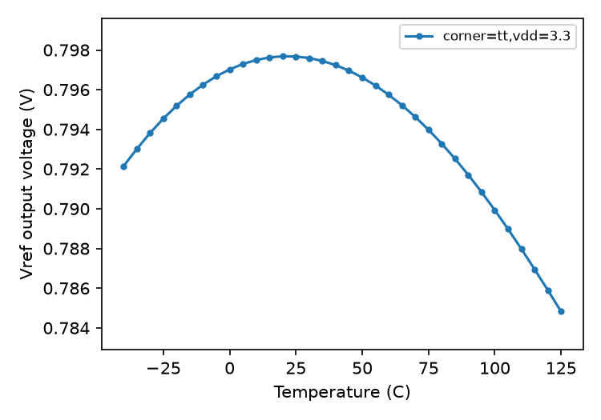

### temp_sweep — Vdd1.8

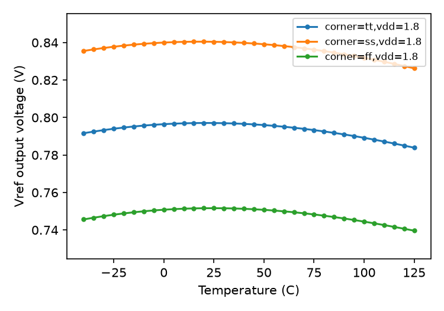

### temp_sweep — Worst

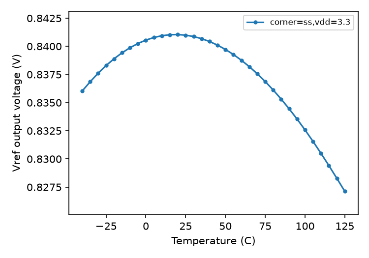

### vref_mismatch — Reference Current

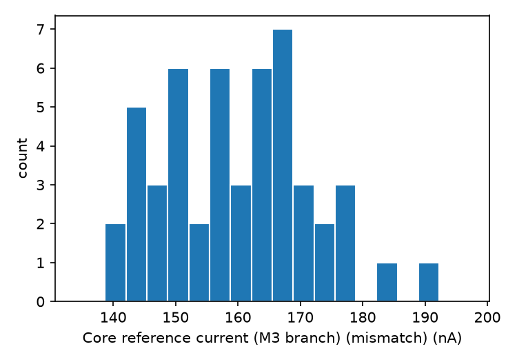

### vref_mismatch — Vref

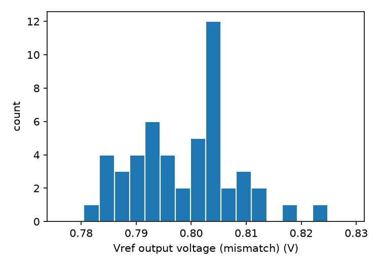

### vref_stat — Reference Current

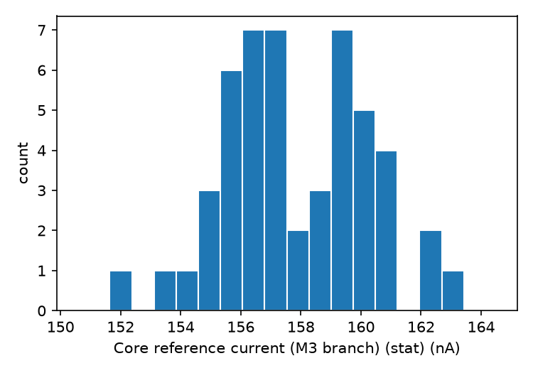

### vref_stat — Vref

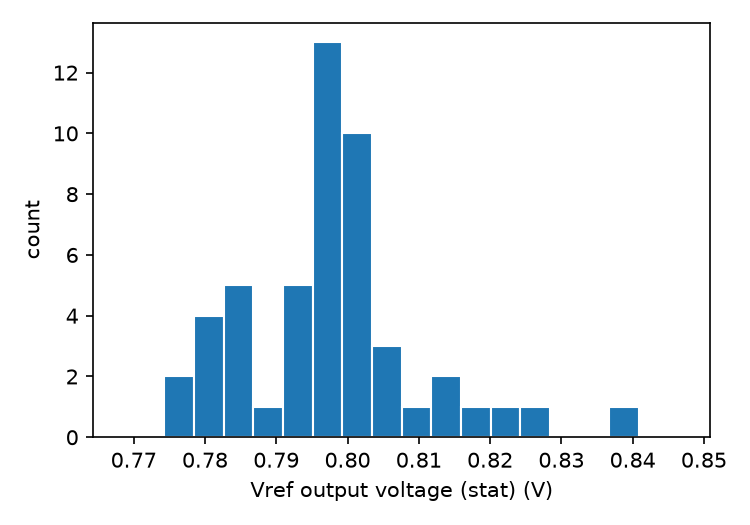

## LVS

netgen reports a **mismatch** between the layout and the schematic of `cmos_vref`.

**Check it yourself:** `cd release/lvs/cmos_vref && ./run_lvs.sh` -- that re-runs this exact comparison with netgen alone (no PDK install, no docker, no simulator), from the two netlists published next to the script, and writes lvs_report_rerun.txt to diff against the published lvs_report.txt.

Published next to this page:
- [`release/lvs/cmos_vref/lvs_report.txt`](../../lvs/cmos_vref/lvs_report.txt)
- [`release/lvs/cmos_vref/lvs_report.json`](../../lvs/cmos_vref/lvs_report.json)
- [`release/lvs/cmos_vref/cmos_vref_extracted_lvs.spice`](../../lvs/cmos_vref/cmos_vref_extracted_lvs.spice)
- [`release/lvs/cmos_vref/cmos_vref_schematic.spice`](../../lvs/cmos_vref/cmos_vref_schematic.spice)
- [`release/lvs/cmos_vref/netgen_setup.tcl`](../../lvs/cmos_vref/netgen_setup.tcl)
- [`release/lvs/cmos_vref/run_lvs.sh`](../../lvs/cmos_vref/run_lvs.sh)

Nets: 11 in the layout, 11 in the schematic.

| Device class | Layout | Schematic |
|---|---|---|
| cap_cmomf | 1 | 1 |
| sg13_hv_nmos | 11 | 10 |
| sg13_hv_pmos | 3 | 3 |

### Net mismatches (1)

| Kind | Layout | Schematic |
|---|---|---|
| connectivity mismatch | vss_uq3 — sg13_hv_nmos/D\|S = 6, sg13_hv_nmos/B = 11, sg13_hv_nmos/G = 1 | vss — sg13_hv_nmos/D\|S = 4, sg13_hv_nmos/B = 10 |

### Instance mismatches (1)

| Kind | Layout | Schematic |
|---|---|---|
| extra device (layout only) | sg13_hv_nmos_2XZV6D:sbvfcm_M6_M7_d01/sg13_hv_nmos:0 — D = 18, G = 18, B = 18 | (no matching instance) — = 0 |
