# output_amp — default

**Variation ID:** `output_amp-default-be0d58`  
**Exported:** 2026-10-23T07:06:42  
**Layout:** published  
**LVS:** clean

Two-stage Miller-compensated CMOS op-amp: NMOS differential pair with cascode stack and active PMOS mirror load, common-source PMOS output driver. Used as a unity-feedback DC buffer for cmos_vref.

## Schematic

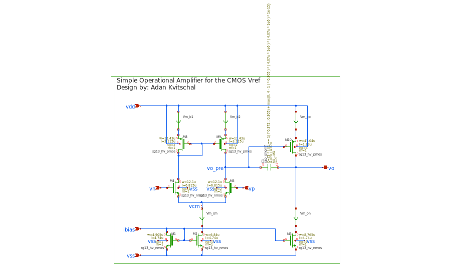

## Layout

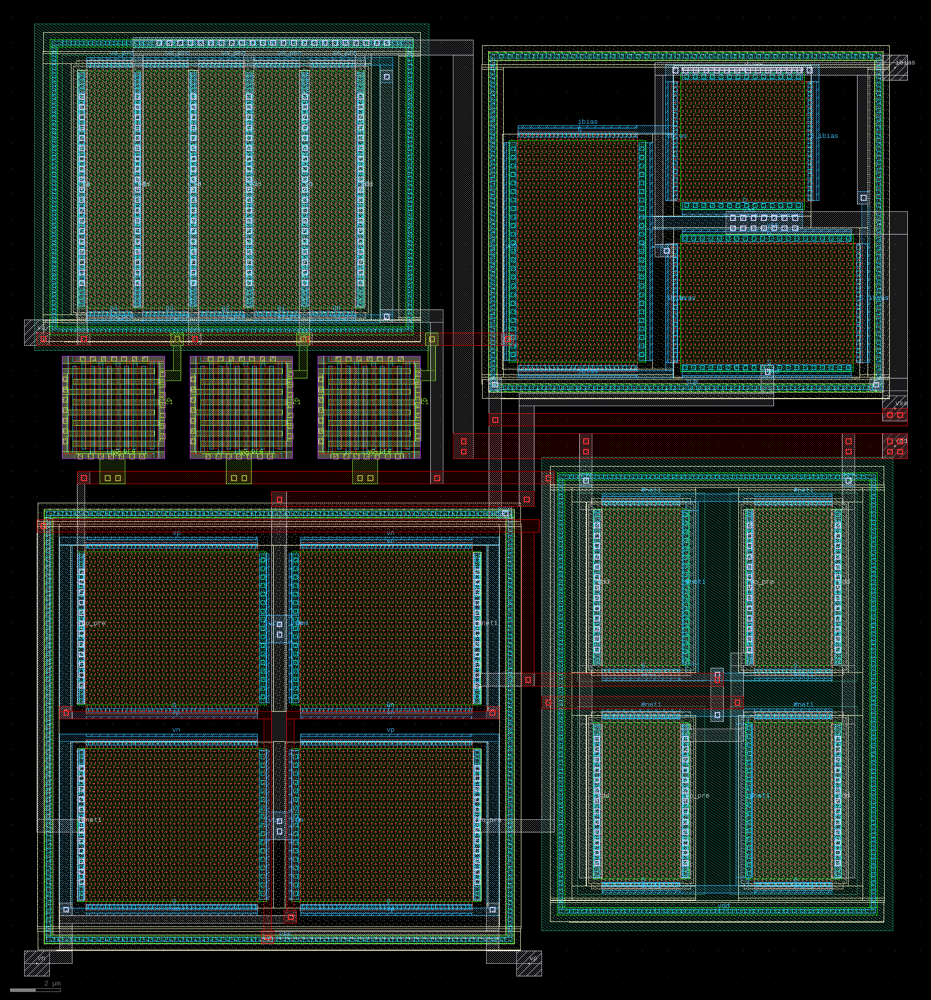

- Magic cells (what a designer edits): [`layout/output_amp/output_amp-default-be0d58/`](../../../layout/output_amp/output_amp-default-be0d58/)
- GDS of that cell: [`release/layout/output_amp/output_amp.gds`](../../layout/output_amp/output_amp.gds)

## Parameters

| Parameter | Value | Description |
|---|---|---|
| nbias_length | 4.74u | Channel length shared by M1/M2/M3 (ibias mirror legs: diode reference, diffpair tail, output pull-down bias) |
| m1_width | 4.905u | Channel width of M1 (diode-connected reference of the ibias mirror) |
| m2_width | 6.84u | Channel width of M2 (tail current source of the differential pair) |
| m3_width | 8.765u | Channel width of M3 (output stage pull-down current source) |
| m4m5_length | 6.815u | Channel length of M4/M5 (differential pair input transistors). This PDK has no separate device to place in the M6/M7 cascode position above them (removed 2026-09-28), so this is now the diffpair's ONLY channel length -- max raised from 5u to 10u to keep room for the series-length equivalent of the removed cascode stack (translated samples land up to ~8.2u). |
| m4m5_width | 12.1u | Channel width of M4/M5 (differential pair input transistors) |
| m8m9_length | 3.115u | Channel length of M8/M9 (first-stage active PMOS current-mirror load) |
| m8m9_width | 12.43u | Channel width of M8/M9 (first-stage active PMOS current-mirror load) |
| m10_length | 1.83u | Channel length of M10 (second-stage common-source PMOS pull-up driver, gate=vo_pre, drain=vo) |
| m10_width | 47.04u | Channel width of M10 (second-stage common-source PMOS pull-up driver) |
| millercap_side | 4.07u | Side length of the square MiM Miller compensation capacitor C1 (w=l=side), bridging vo_pre and vo (cap_cmomf, M1-M4: 1.287 fF/um^2; sized to keep the former cap_cmim (1.5 fF/um^2) total capacitance, i.e. side x1.08) |
| millercap_mult | 3 | Instance multiplier (m=) of the Miller compensation capacitor C1 |
| m1_ng (ƒx) | 1 | M1: number of fingers so each finger is <= w_finger_max wide (w=m1_width is the total width of one instance). |
| m2_ng (ƒx) | 1 | M2: number of fingers so each finger is <= w_finger_max wide (w=m2_width is the total width of one instance). |
| m3_ng (ƒx) | 1 | M3: number of fingers so each finger is <= w_finger_max wide (w=m3_width is the total width of one instance). |
| m4_ng (ƒx) | 2 | M4: number of fingers so each finger is <= w_finger_max wide (w=m4m5_width is the total width of one instance). |
| m5_ng (ƒx) | 2 | M5: number of fingers so each finger is <= w_finger_max wide (w=m4m5_width is the total width of one instance). |
| m8_ng (ƒx) | 2 | M8: number of fingers so each finger is <= w_finger_max wide (w=m8m9_width is the total width of one instance). |
| m9_ng (ƒx) | 2 | M9: number of fingers so each finger is <= w_finger_max wide (w=m8m9_width is the total width of one instance). |
| m10_ng (ƒx) | 5 | M10: number of fingers so each finger is <= w_finger_max wide (w=m10_width is the total width of one instance). |

## Design profile

Matched profile: **low_power** (6/6 constraints) — FOM: 502M

| Profile | Score | FOM | Description |
|---|---|---|---|
| low_power | 6/6 | 502M | Notably lower current consumption and area than the spec requires, while keeping gain/phase margin/PSRR/load regulation within acceptable bounds |

## Test results

**Post-layout column:** from the extracted netlist of this block's layout, for the typical condition only (no corner/sweep matrix -- so these are NOT comparable to the Min/Max columns, which sweep every condition). Parasitics: capacitance only (no interconnect resistance). Tests re-run post-layout: `openloop_ac`, `psrr`.

| Test | Metric | Typical | Post-layout (Δ) | Min | Max | Mean | Std | Unit | Spec | Pass |
|---|---|---|---|---|---|---|---|---|---|---|
| area | Estimated layout area | 1188 |  | 1188 | 1188 |  |  | µm² |  | PASS |
| current_consumption | Output amp current consumption | 0.4246 |  | 0.339 | 0.5109 |  |  | uA |  | PASS |
| load_reg | Load regulation | 0.02035 |  | 0.01295 | 89.84 |  |  | % |  | PASS |
| noise | Output-referred noise | 0.3448 |  | 0.317 | 0.3737 |  |  | nV/sqrt(Hz) |  |  |
| openloop_ac | Open-loop DC gain | 51.83 | 51.82 (-0.0%) | 49.18 | 52.96 |  |  | dB |  | PASS |
| openloop_ac | Phase margin | 78.41 | 79.18 (+1.0%) | 78.18 | 78.98 |  |  | deg | ≥ 45 deg | PASS |
| openloop_ac | Unity-gain bandwidth | 344.7 | 277.4 (-19.5%) | 229.9 | 434.4 |  |  | kHz |  |  |
| psrr | PSRR @ 1kHz | 71.9 | 71.18 (-1.0%) | 70.11 | 73.36 |  |  | dB | ≥ 50 dB | PASS |

## Plots

### current_consumption — plot

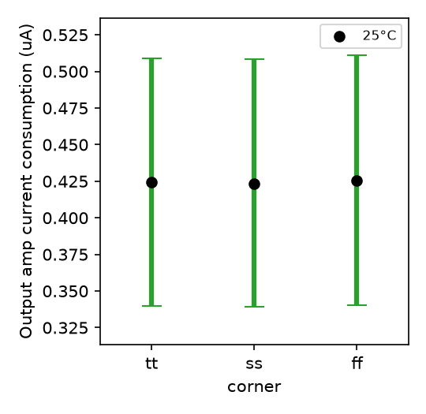

### load_reg — All

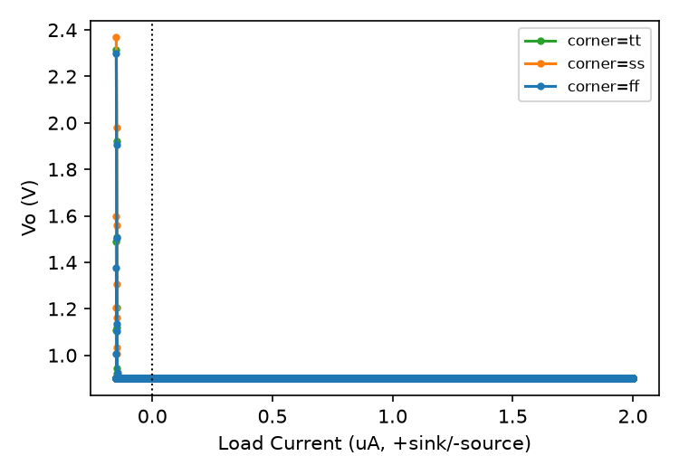

### load_reg — Typical

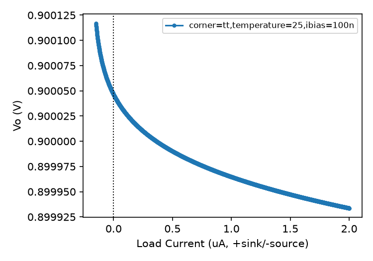

### load_reg — Worst

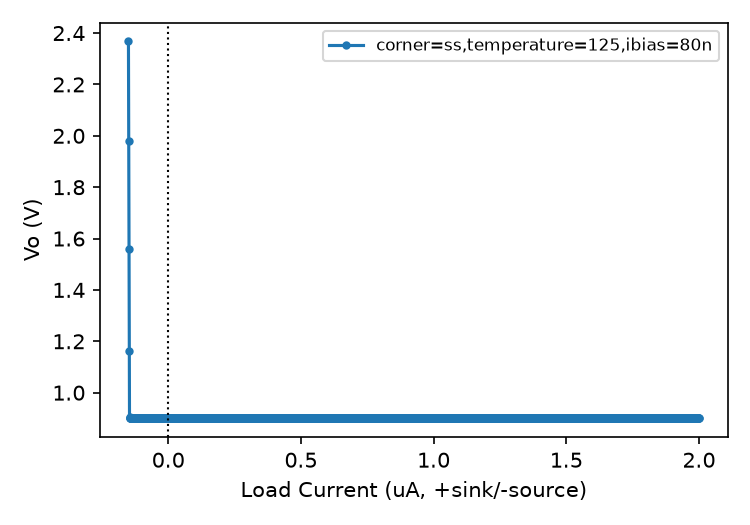

### noise — plot

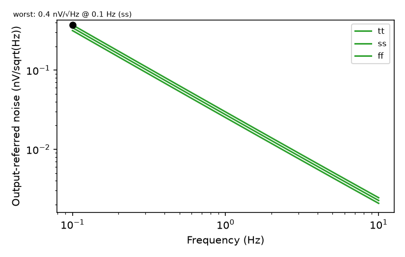

### openloop_ac — Typical

| Schematic | Post-layout (extracted) |
|---|---|
| 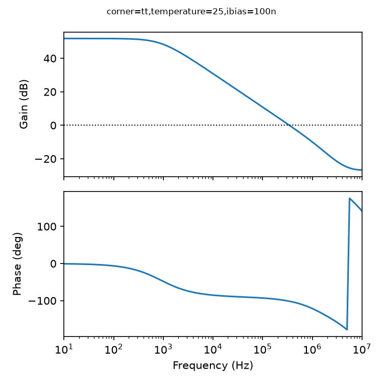 | 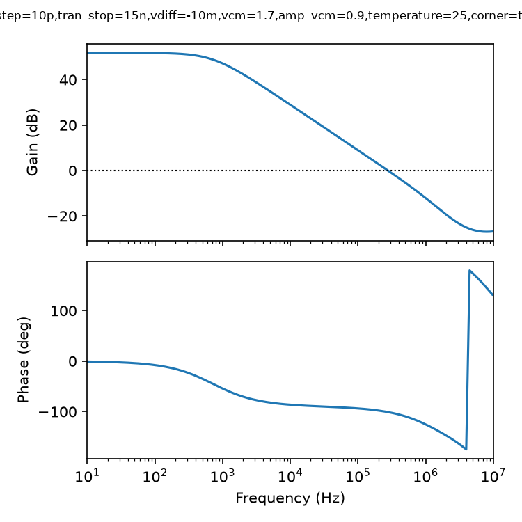 |

### openloop_ac — Worst Case

| Schematic | Post-layout (extracted) |
|---|---|
| 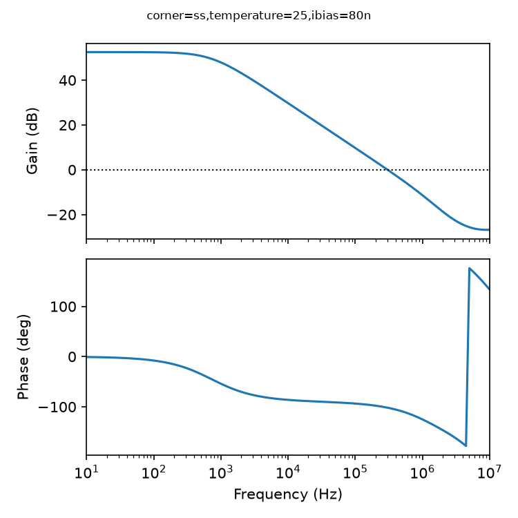 |  |

### psrr — plot

| Schematic | Post-layout (extracted) |
|---|---|
| 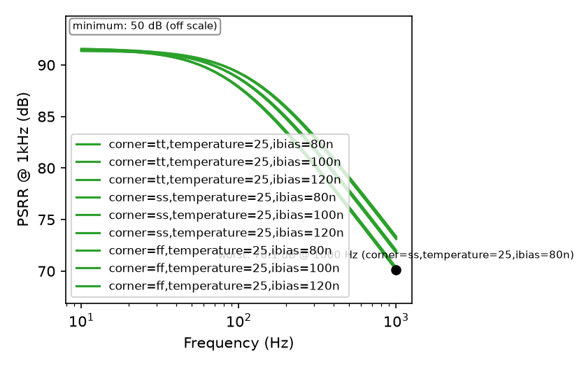 | 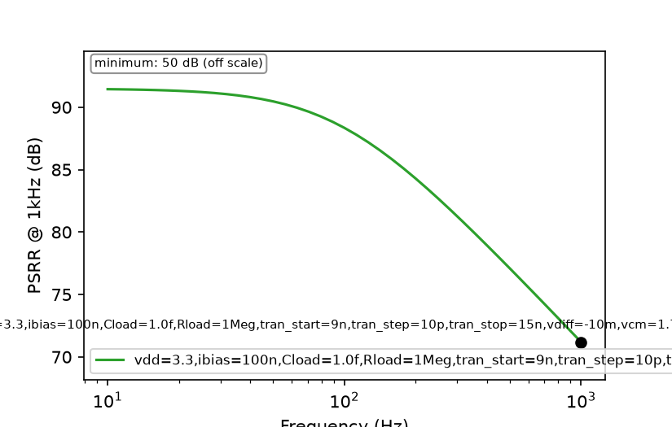 |

## LVS

netgen reports the layout and the schematic of `output_amp` **match**.

**Check it yourself:** `cd release/lvs/output_amp && ./run_lvs.sh` -- that re-runs this exact comparison with netgen alone (no PDK install, no docker, no simulator), from the two netlists published next to the script, and writes lvs_report_rerun.txt to diff against the published lvs_report.txt.

Published next to this page:
- [`release/lvs/output_amp/lvs_report.txt`](../../lvs/output_amp/lvs_report.txt)
- [`release/lvs/output_amp/lvs_report.json`](../../lvs/output_amp/lvs_report.json)
- [`release/lvs/output_amp/output_amp_extracted_lvs.spice`](../../lvs/output_amp/output_amp_extracted_lvs.spice)
- [`release/lvs/output_amp/output_amp_schematic.spice`](../../lvs/output_amp/output_amp_schematic.spice)
- [`release/lvs/output_amp/netgen_setup.tcl`](../../lvs/output_amp/netgen_setup.tcl)
- [`release/lvs/output_amp/run_lvs.sh`](../../lvs/output_amp/run_lvs.sh)

Nets: 9 in the layout, 9 in the schematic.

| Device class | Layout | Schematic |
|---|---|---|
| cap_cmomf | 1 | 1 |
| sg13_hv_nmos | 5 | 5 |
| sg13_hv_pmos | 3 | 3 |
