# top — default

**Variation ID:** `top-default-5997f5`  
**Exported:** 2026-10-23T07:06:41  
**Layout:** published  
**LVS:** mismatch

Vref core + output buffer amp integration: cmos_vref (X1) generates vref/pbias/vbg*, output_amp (x2) buffers it, plus a PMOS bias mirror (M1, sized off cmos_vref's own M3), an enable switch (M2), and trim resistors/switches (R1-R8/M6-M9).

**Sub-block dependencies:** X1 (cmos_vref): `cmos_vref-default-5f7415`, x2 (output_amp): `output_amp-default-be0d58` — their materialized schematics (and, for a real registered variation, their own release/doc/ page) are kept in sync with these exact choices every time this block is exported.

## Schematic

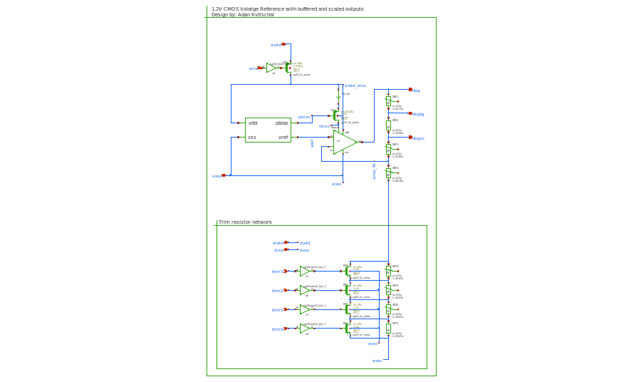

## Layout

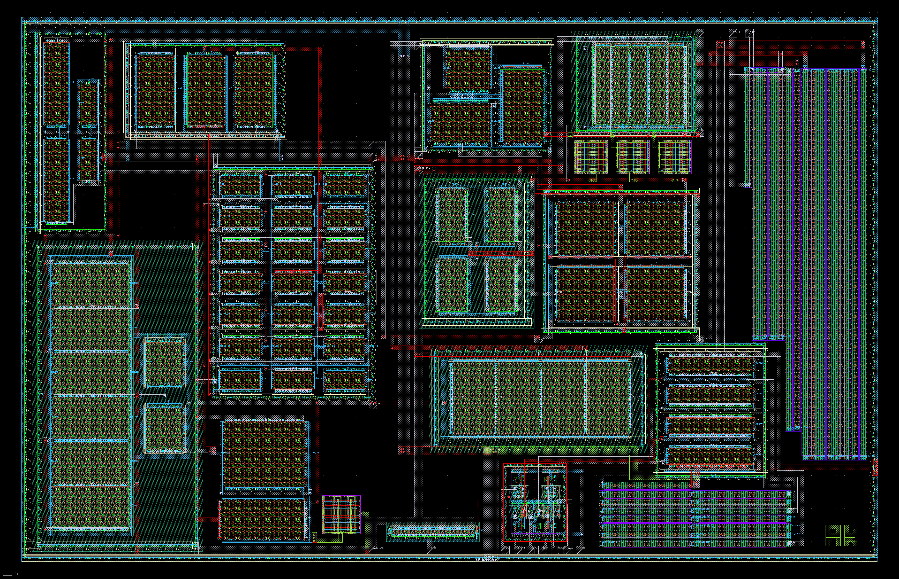

- Magic cells (what a designer edits): [`layout/top/top-default-5997f5/`](../../../layout/top/top-default-5997f5/)
- GDS of that cell: [`release/layout/top/top.gds`](../../layout/top/top.gds)

## Parameters

| Parameter | Value | Description |
|---|---|---|
| X1_variation | cmos_vref-default-5f7415 | Which cmos_vref/default variation composes X1 in this top variation -- a real registered variation name, or the reserved value "defaults" (cmos_vref/default's own config.json defaults, no variation needs to be registered first). |
| x2_variation | output_amp-default-be0d58 | Which output_amp/default variation composes x2 in this top variation -- same convention as X1_variation. |
| ena_length | 0.45u | Channel Length of M2 (PMOS enable switch, avdd -> the vref core's own supply). The sky130_ak_ip__cmos_vref sibling project's equivalent (M20) uses L=0.3u, but that's below this PDK's own sg13_hv_pmos minimum (see cmos_vref's own pbias_length/m2_length, both min=0.40-0.45u) -- clamped up to 0.45u, the smallest value actually valid for this device on this PDK. |
| ena_width | 10u | Channel Width of M2 (PMOS enable switch). Matches the sky130_ak_ip__cmos_vref sibling project's equivalent (M20, W=10u). |
| trim_switch_length | 2u | Channel Length of the M6-M9 trim network switches (NMOS, gate driven by trim0-trim3 via a sg13cmos5l_buf_1 buffer). Matches the sky130_ak_ip__cmos_vref sibling project's equivalent (trim_res.sch's M1-M4, L=2u). |
| trim_switch_width | 10u | Channel Width of the M6-M9 trim network switches. Matches the sky130_ak_ip__cmos_vref sibling project's equivalent (trim_res.sch's M1-M4, W=10u). |
| base_width | 0.5u | Shared width of R1-R8 (the vbg/vbgtg/vbgsc feedback divider + its R5-R8 binary trim network, sch/top/top_default.sch). IHP's rhigh model (shared verbatim between sg13g2 and sg13cmos5l) doesn't document a fixed/DRC-mandated width the way sg13_hv_pmos/nmos do for length (see ena_length's own note) -- this is exposed as a free parameter rather than pinned, so if a real width-fixing design rule turns up later this can be clamped to it (min=max) without touching the resistor formulas themselves, which only ever reference 'base_width' symbolically. |
| rfeedback_total | 2Meg | Target sum of the whole R1..R8 series chain (vbg down to avss) at the CENTER trim code (7.5, see vbg_target/rbot_nominal) -- the feedback network's total impedance around output_amp. Every resistor's length is a fixed or vref-dependent FRACTION of this single knob (see r1_length..r4_length and r_trim_unit_length below), so raising it lowers the network's loading current 1:1 without touching the vbg/vbgtg/vbgsc voltage ratios. min=800k is a current-limit floor, derived from a 1.5uA margin below output_amp's own tb/output_amp/tb_amp_load_reg.sch test, which VERIFIED the output stage's load regulation stays well within spec (0.017-0.027% typical vs. a 0.50% max) with iload swept up to 2uA -- 800k = vbg_target/1.5uA, a buffer below that 2uA edge (the edge of what was actually tested, not a proven ceiling), replacing an earlier, unverified 1.2uA placeholder. NEITHER this floor NOR the divider's own current accounts for any external load drawn from the exposed vbg/vbgtg/vbgsc chip pins by other on-chip peripherals -- no such budget is specified anywhere in this project (top.sym declares them dir=out, but no consumer/current spec is documented for whatever attaches to them) -- a real peripheral load, once known, must be subtracted from this margin before this floor can be trusted as a true ceiling. |
| trim_factor | 0.3 | Fraction of rbot_full (see derived_parameters.formulas below) given to the removable R5-R8 binary trim network (weights 1:2:4:8, matching M6-M9/trim0-3) instead of to the fixed floor R4. trim_factor=0 collapses R5-R8 to 0 ohm each (M6-M9 switching becomes a no-op, Rbot is permanently R4=rbot_full); trim_factor=1 collapses R4 to 0 ohm (every bit of Rbot is removable, down to a 0-ohm floor with all of trim0-3 asserted). All 4 switches open (trim0-3='0', code 0) always gives Rbot=rbot_full regardless of trim_factor, since R4+R5+R6+R7+R8 = rbot_full*((1-trim_factor)+trim_factor) by construction; the CENTER of the 16-code range (code 7.5) gives Rbot=rbot_full*(1-trim_factor/2) = rbot_nominal (see rbot_nominal/rbot_full's own descriptions -- this is what fits the X1-typical design point to the MIDDLE of the trim range instead of to code 0, so trim can correct vbg in BOTH directions from that middle point, not just up from code 0). Bumped 0.1 -> 0.3 after tb/top's own trim_range test (16-code vbg sweep vs. corner/temperature) showed 0.1's total swing (~29mV @ typical) couldn't cover the 'ff' corner's ~80-90mV deficit from 1200mV even with the full 16 codes -- re-verify against trim_range before trusting any further change here. rfeedback_total puts a ceiling on how high this can go without a negative-length R3 (see r3_length's own formula: rfeedback_total*vbgsc_target/vbg_target must stay above rbot_nominal, which grows as trim_factor -> 1) -- at the current rfeedback_total=2Meg/rbot_nominal defaults that ceiling is roughly trim_factor<0.44; raise rfeedback_total's own max (currently 10Meg) first if more range is ever needed than that allows. |
| vbg_target | 1.2 | Target voltage at vbg (the bandgap-standard output tap, Chipalooza #1/#2 spec), at the CENTER trim code (7.5). Referenced by name from rbot_nominal's formula and r1/r2/r3_length's own formulas below -- single source of truth, no hand-pasted duplicate literal anywhere else in this file. Must stay strictly greater than vbgtg_target/vbgsc_target -- NOT enforced automatically by this schema (no cross-parameter check exists in check_params.py or resolve_formulas); a sampler/optimizer picking values that violate this ordering produces a negative r1/r2/r3_length, which fails loudly at materialization (not silently) rather than producing a wrong-but-plausible result. |
| vbgtg_target | 1.048 | Target voltage at vbgtg, at the CENTER trim code (7.5) -- feeds an undocumented downstream temperature-sensor-related consumer (Chipalooza #1/#2 spec; no consumer detail is documented anywhere in this repo). See vbg_target's own note on the (unenforced) required ordering vbgsc_target < vbgtg_target < vbg_target. |
| vbgsc_target | 1.024 | Target voltage at vbgsc, at the CENTER trim code (7.5) -- eases downstream A/D conversion (undocumented consumer, same Chipalooza #1/#2 spec as vbgtg_target). See vbg_target's own note on the (unenforced) required ordering vbgsc_target < vbgtg_target < vbg_target. |
| pbias_length (ƒx) | 5u | M1's own length, shared with X1's own pbias_length (M1 and M3 share gate 'pbias', length 'pbias_length', and source rail -- a matched current mirror). A pure passthrough -- imported DIRECTLY under the schematic's own token name, no formula wrapper needed, so it resolves independently of amp_bias_width's own import_metrics dependency below (see that entry's own KNOWN LIMITATION note). |
| x1_m3_width (ƒx) | 54.48u | cmos_vref's own M3 width -- the base value amp_bias_width's own formula (below) scales from. |
| x1_ref_current_typical (ƒx) | 158.10258000000002 | X1's own measured M3-branch reference current (typical corner/temp) -- feeds amp_bias_width's own formula below. KNOWN LIMITATION (measured, not fixed): this is a single-shot, open-loop estimate -- cmos_vref's reference_current test measures M3 on a clean, directly-set 1.8V supply, but inside `top` the same core is fed through the M2 enable-switch PMOS, which drops tens of mV; combined with this mirror apparently running in weak/moderate inversion (VSG close to Vth), that supply difference alone was observed to cause a ~3x mismatch between the calculated target and the actual delivered current at the default parameter set (see tb/top's own amp_bias_current test, which measures the real thing and is expected to fail until this is revisited -- e.g. by hand-tuning amp_bias_width's own formula against that test's own result, or by improving the calibration environment). Treat this as a best-effort starting point, not a guarantee. |
| x1_vref_typical (ƒx) | 0.79767305 | X1's own measured typical vref DC output (tt corner, sample closest to 25C -- see tb/cmos_vref/tb_vref_temp_sweep.py's evaluate() and tb/_shared/parser_common.typical_min_max()) -- feeds rbot_nominal below so R1-R8's own sizing tracks whichever cmos_vref variation composes X1, regardless of what m3_width/etc. the optimizer picked for cmos_vref's own, unrelated specs (Vref accuracy/TC/consumption). Uses 'typical' rather than 'min'/'max' (a range across the WHOLE temperature/corner sweep, not a single design-point reading) -- sizing off either extreme would size the divider for a corner X1 isn't even necessarily run at. |
| amp_bias_width (ƒx) | 34.46u | M1's mirrored bias width, calculated (not free) -- scaled from cmos_vref's own m3_width (x1_m3_width) so that M1's mirrored current is INTENDED to land on output_amp's 100nA design point, REGARDLESS of what m3_width the optimizer picks for cmos_vref's own, unrelated specs and regardless of which cmos_vref variation X1_variation selects. Replaces an earlier free 'amp_bias_factor' parameter (integer, 1-10) that could only scale the mirrored current UP relative to cmos_vref's own core current, never down. See x1_ref_current_typical's own KNOWN LIMITATION note above (single-shot open-loop estimate, ~3x mismatch observed against tb/top's own amp_bias_current test) -- treat this as a best-effort starting point, not a guarantee. |
| rbot_nominal (ƒx) | 1.329e+06 | The Rbot (R4+R5..R8-effective) value that lands vbg on exactly vbg_target for X1's own actual measured typical vref DC output (x1_vref_typical) -- NOT the code-0 (all switches open) Rbot value (that's rbot_full below, which is what R4..R8's OWN lengths are actually sized from). Originally this WAS the code-0 Rbot directly, but tb/top's own trim_range test (16-code vbg sweep vs. corner/temperature) showed that scheme has no code that can lower vbg for any corner whose own untrimmed (code-0) vbg already reads above vbg_target, since the R5-R8/M6-M9 network only ever SHORTS resistance out of Rbot from its code-0 maximum -- trim could only ever push vbg UP from a code-0 baseline, never down. Recentering this value onto the MIDDLE of the 16-code range (code 7.5) instead -- rbot_full inflates it back up to what code 0 needs to be for that -- gives half the trim codes downward headroom (for corners like 'ff', which read below vbg_target untrimmed) and half upward (for corners like 'ss', which read above). rfeedback_total*x1_vref_typical/vbg_target: grows WITH the measured vref, same relationship as before this schema's own vbg_target/vbgtg_target/vbgsc_target parameters replaced the old cross_block 'scale_to_target'/'invert' mechanism -- this is now plain, ordinary arithmetic instead of an implicit ratio flag. R1/R2 (the fixed 'de cima' resistors) are pure arithmetic on rfeedback_total/vbg_target/vbgtg_target/vbgsc_target; R3/R4..R8 additionally depend on this value -- see r1_length..r4_length and r_trim_unit_length below. IMPORTANT: R1+R2+R3 are sized so that R1+R2+R3+rbot_nominal = rfeedback_total AT THE CENTER CODE (7.5) -- the SAME code vbg_target/vbgtg_target/vbgsc_target are themselves defined at -- not at code 0 (that was a confirmed bug in an earlier version of this schema: r3_length subtracted rbot_full, the code-0 Rbot, instead of rbot_nominal, which made vbg land on vbg_target only when trim_factor=0; verified both symbolically and empirically against real simulation data before this fix). |
| rbot_full (ƒx) | 1.564e+06 | R4+R5+R6+R7+R8 combined AT trim0-3='0' (code 0, all switches open, the network's maximum Rbot) -- inflated from rbot_nominal (the CENTER-code, code 7.5, Rbot) by 1/(1-trim_factor/2): Rbot(code) is linear in code from Rbot_full at code=0 down to Rbot_full*(1-trim_factor) at code=15 (see r4_length and r_trim_unit_length below), so Rbot(7.5) = rbot_full*(1-trim_factor/2) -- setting that equal to rbot_nominal and solving for rbot_full gives this expr. Exists because tb/top's own trim_range test (16-code vbg sweep across corner/temperature) showed a code-0-baseline scheme has no code that can lower vbg for any corner whose own untrimmed vbg already reads above vbg_target (every 'ss' corner/temperature point measured): the R5-R8/M6-M9 network only ever SHORTS resistance out (Rbot can only shrink from code 0), so a code-0 baseline can only trim vbg UP, never down. Centering the nominal (X1-typical) fit on the MIDDLE code instead gives half the code range downward headroom (below-target corners, e.g. 'ff') and half upward (above-target corners, e.g. 'ss') -- trim_factor still needs to be large enough that half of the resulting swing covers each side's actual deficit (checked empirically via trim_range, not derivable in closed form from this formula alone: the amp's real non-inverting gain is vbg = vref_core*(1 + Rtop/Rbot(code)), not the simpler vbg=vref_core*rfeedback_total/Rbot this project's own r3_length/r4_length comments used to describe -- that simpler form only holds exactly AT whichever code Rtop+Rbot(code) equals rfeedback_total, i.e. at the recentered code 7.5 here, per rbot_nominal's own corrected derivation above). |
| r1_length (ƒx) | 42.73u | R1's length (sch/top/top_default.sch, w='base_width'): inverts the rhigh model's own R(w,l) formula (value=expr_eng(...) on the symbol itself: R = 1.6e-4/w + 1360*l/(w-0.04e-6) at b=0,m=1) to hit a target R = rfeedback_total*(vbg_target-vbgtg_target)/vbg_target ohm -- the vbg-to-vbgtg fraction of the total feedback chain, from live target parameters instead of a hand-pasted decimal (was 0.1266667*rfeedback_total, hand-computed once from the old fixed 1200/1048mV literals). Independent of rbot_nominal/trim_factor -- this segment sits entirely above the amp's own feedback tap, so it never changes with X1's measured vref or the trim code. SEGMENTED: R1 is R1[1:0] in sch/top/top_default.sch, r1_segments=2 identical straight segments in series (an xschem vector instance chained by bus labels), so this is the length of ONE segment: target/r1_segments minus one head. A serpentine (rhigh b>0) is not used because Magic does not extract snake resistors of this PDK correctly (both terminals on one node, garbage w -- checked 2026-09-26), so LVS could never pass. |
| r2_length (ƒx) | 13.42u | R2's length, same construction as r1_length, targeting R = rfeedback_total*(vbgtg_target-vbgsc_target)/vbg_target ohm -- the vbgtg-to-vbgsc fraction (was 0.02*rfeedback_total, hand-computed once from the old fixed 1048/1024mV literals). |
| r3_length (ƒx) | 31.83u | R3's length, targeting R = rfeedback_total*vbgsc_target/vbg_target - rbot_nominal ohm -- the vbgsc-down-to-the-amp's-feedback-tap fraction (was 0.8533333*rfeedback_total, hand-computed once from the old fixed 1024mV literal), MINUS rbot_nominal (the CENTER-code, i.e. code 7.5, Rbot) -- NOT rbot_full (code-0 Rbot), which an earlier version of this formula incorrectly used (a confirmed bug: R1+R2+R3+Rbot must equal rfeedback_total at the SAME code point vbg_target/vbgtg_target/vbgsc_target are themselves defined at -- code 7.5 -- not at code 0; see rbot_nominal's own description above for the full derivation and empirical confirmation of the fix). SEGMENTED: R3 is R3[1:0] in sch/top/top_default.sch, r3_segments=2 identical straight segments in series (an xschem vector instance chained by bus labels), so this is the length of ONE segment: target/r3_segments minus one head. A serpentine (rhigh b>0) is not used because Magic does not extract snake resistors of this PDK correctly (both terminals on one node, garbage w -- checked 2026-09-26), so LVS could never pass. |
| r4_length (ƒx) | 46.18u | R4's length -- the fixed floor of the 'de baixo' network (M6-M9 all open still leaves R4 in circuit), targeting R = (1-trim_factor)*rbot_full ohm. Combined with the 15 trim units (r_trim_unit_length: R5..R8 together add up to trim_factor*rbot_full), R4+R5+R6+R7+R8 = rbot_full at code 0 (all switches open) and shrinks linearly, by design, down to rbot_full*(1-trim_factor) at code 15 (all switches shorted) -- see rbot_full's own description for why code 0's total is rbot_full, not rbot_nominal, since rbot_nominal names the CENTER-code (7.5) Rbot instead. SEGMENTED: R4 is R4[7:0] in sch/top/top_default.sch, r4_segments=8 identical straight segments in series (an xschem vector instance chained by bus labels), so this is the length of ONE segment: target/r4_segments minus one head. A serpentine (rhigh b>0) is not used because Magic does not extract snake resistors of this PDK correctly (both terminals on one node, garbage w -- checked 2026-09-26), so LVS could never pass. |
| r_trim_unit_length (ƒx) | 10.47u | Length of ONE unit resistor of the 1:2:4:8 binary trim network, targeting R_unit = trim_factor*rbot_full/15 ohm (1 of the 1+2+4+8=15 removable units, out of rbot_full -- the code-0 total, see rbot_full's own description). The trim resistors are strings of identical units in series (sch/top/top_default.sch: R5 = 1 unit, R6[1:0] = 2, R7[3:0] = 4, R8[7:0] = 8, xschem vector instances chained by bus labels), each unit with its own heads (the 1.6e-4/w term), so the 1:2:4:8 ratio is exact by construction -- also across process spread of the head/contact resistance, which the former per-resistor lengths (r5_length..r8_length, each subtracting ONE head from its own target) did not track. Nominal values are unchanged: unit k-string = k * R_unit, as before. M6/M7/M8/M9 (trim0..trim3) short R5/R6/R7/R8 out. |
| m1_ng (ƒx) | 4 | M1: number of fingers so each finger is <= w_finger_max wide (w=amp_bias_width is the total width of one instance). |
| m2_ng (ƒx) | 1 | M2: number of fingers so each finger is <= w_finger_max wide (w=ena_width is the total width of one instance). |
| m6_ng (ƒx) | 1 | M6: number of fingers so each finger is <= w_finger_max wide (w=trim_switch_width is the total width of one instance). |
| m7_ng (ƒx) | 1 | M7: number of fingers so each finger is <= w_finger_max wide (w=trim_switch_width is the total width of one instance). |
| m8_ng (ƒx) | 1 | M8: number of fingers so each finger is <= w_finger_max wide (w=trim_switch_width is the total width of one instance). |
| m9_ng (ƒx) | 1 | M9: number of fingers so each finger is <= w_finger_max wide (w=trim_switch_width is the total width of one instance). |

## Design profile

Closest profile (not fully matched): **low_power** (3/5 constraints) — FOM: <1

| Profile | Score | FOM | Description |
|---|---|---|---|
| low_power | 3/5 | <1 | Notably lower current consumption (enabled and standby) than the Chipalooza #2 target spec requires, while still meeting the area/TC/PSRR targets (ihp_mh_ip__cmos_vref_proposal.pdf, Table 2) |

## Test results

| Test | Metric | Typical | Min | Max | Mean | Std | Unit | Spec | Pass |
|---|---|---|---|---|---|---|---|---|---|
| amp_bias_current | Output stage bias current | 100.2 | 62.97 | 146.1 |  |  | nA | 80–120 nA |  |
| area | Estimated layout area | 4791 | 4791 | 4791 |  |  | µm² | ≤ 50000 µm² | PASS |
| current_consumption | Top current consumption | 1.213 | 0.9178 | 1.69 |  |  | uA |  | PASS |
| noise | Output-referred noise | 27.03 | 25.12 | 29 |  |  | nV/sqrt(Hz) |  |  |
| psrr | PSRR @ 1kHz | 49.64 | 49.54 | 49.64 |  |  | dB | ≥ 50 dB | FAIL |
| standby_current | Standby current (disabled) | 1.213e+06 | 9.173e+05 | 1.597e+06 |  |  | pA | ≤ 750 pA | FAIL |
| startup | Dominant oscillation frequency (post-ramp tail, FFT) | 0.4338 | 0.4338 | 0.4396 |  |  | MHz |  |  |
| startup | Settled vbg value | 1.204 | 1.136 | 1.269 |  |  | V |  |  |
| startup | Startup overshoot | 171.9 | 157.7 | 188.7 |  |  | % |  |  |
| startup | Startup settling time | 11.01 | 9.569 | 12.1 |  |  | us |  |  |
| startup | vbg peak voltage | 3.274 | 3.271 | 3.279 |  |  | V |  |  |
| temp_sweep | Temperature coefficient (commercial 0-70C) | 57.57 | 52.22 | 62.17 |  |  | ppm/°C |  |  |
| temp_sweep | Temperature coefficient (full -40-125C) | 100.5 | 95.23 | 103.3 |  |  | ppm/°C |  |  |
| temp_sweep | Temperature coefficient (industrial -40-85C) | 53.92 | 53.92 | 63.28 |  |  | ppm/°C |  | PASS |
| temp_sweep | vbg output voltage | 1.204 | 1.118 | 1.269 |  |  | V |  |  |
| trim_range | Best-achievable |vbg - 1200mV| across the 16 trim codes | 4.252 | 1.699 | 4.252 |  |  | mV |  |  |
| trim_range | Trim codes landing vbg within +/-1% of 1200mV | 2 | 2 | 2 |  |  | codes |  |  |
| vbg_mismatch | vbg output voltage (mismatch) |  | 1.184 | 1.244 | 1.203 | 0.01215 | V |  |  |
| vbg_stat | vbg output voltage (stat) |  | 1.148 | 1.261 | 1.206 | 0.02408 | V |  |  |

## Plots

### amp_bias_current — plot

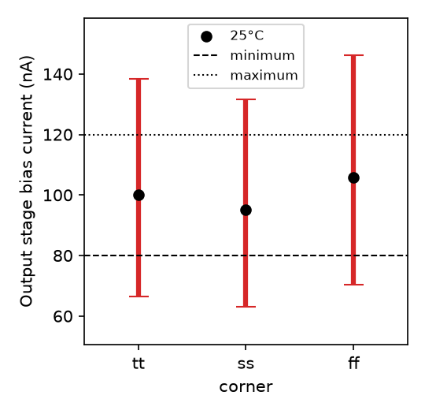

### current_consumption — plot

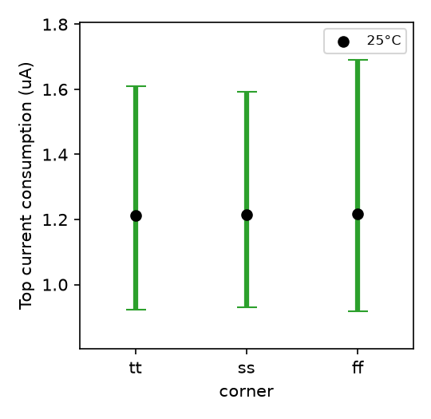

### noise — plot

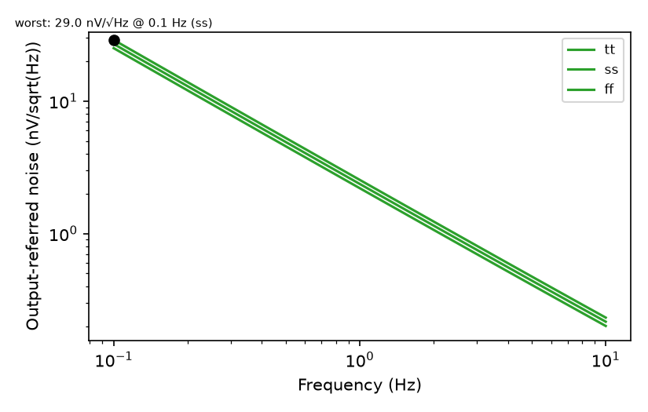

### psrr — plot

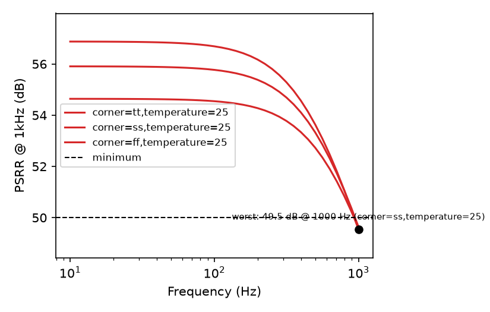

### standby_current — plot

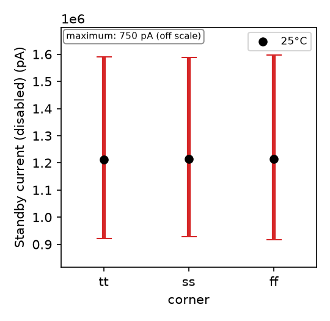

### startup — Spectrum

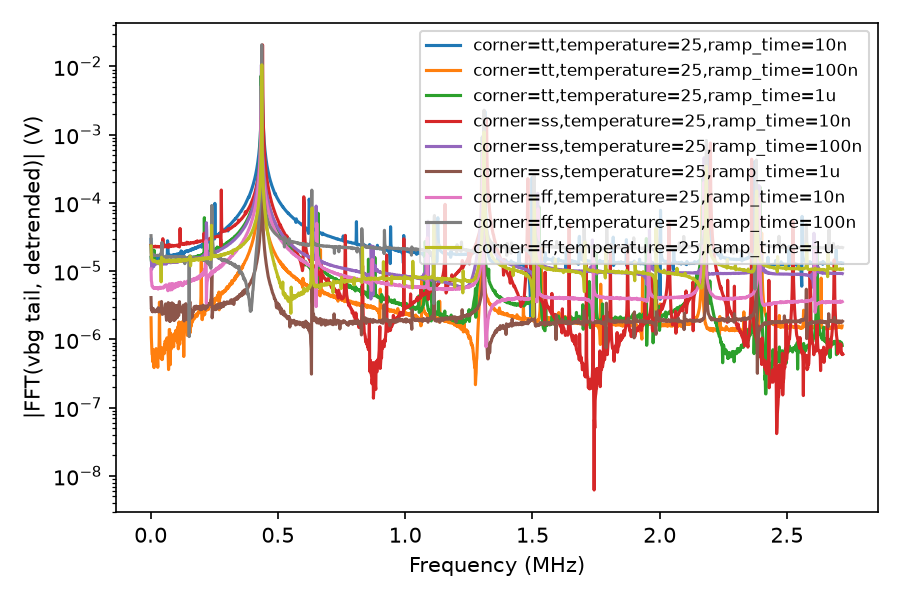

### startup — plot

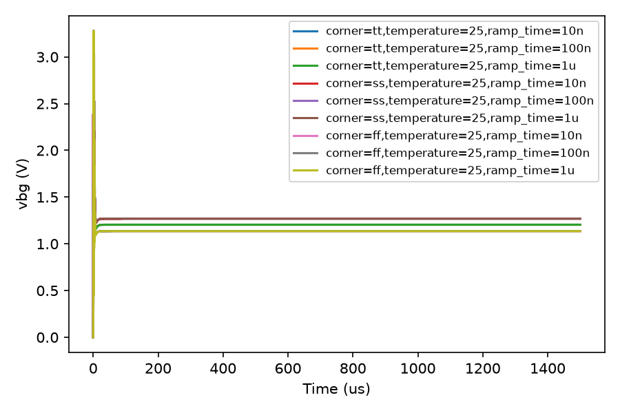

### temp_sweep — All

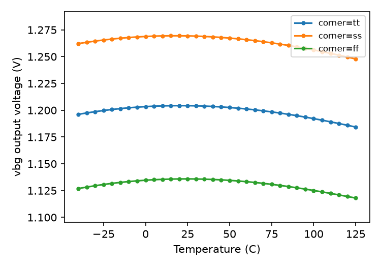

### temp_sweep — Typical

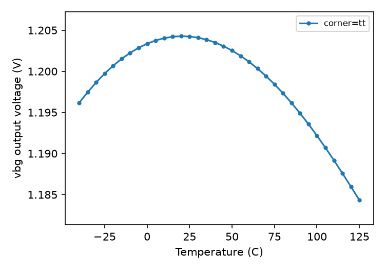

### temp_sweep — Worst

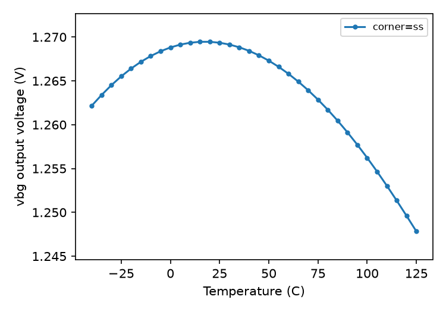

### trim_range — plot

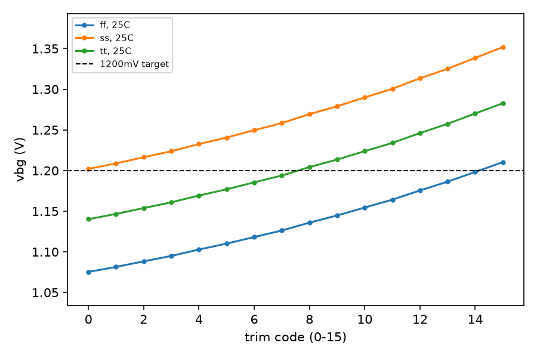

### vbg_mismatch — plot

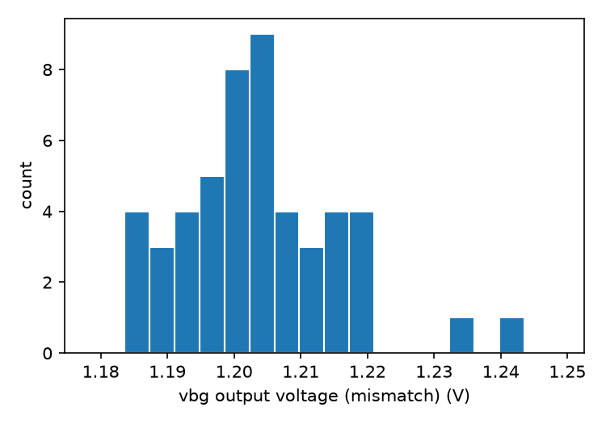

### vbg_stat — plot

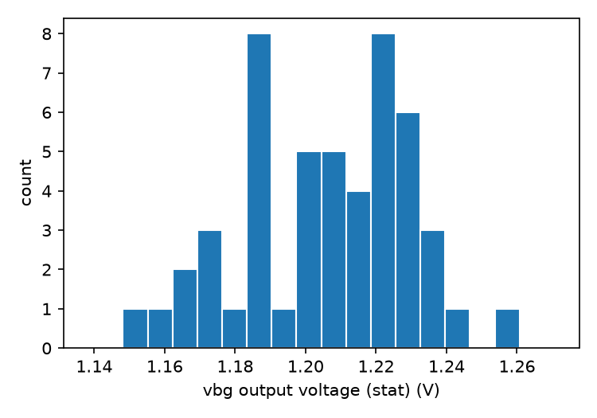

## LVS

netgen reports a **mismatch** between the layout and the schematic of `top`.

**Check it yourself:** `cd release/lvs/top && ./run_lvs.sh` -- that re-runs this exact comparison with netgen alone (no PDK install, no docker, no simulator), from the two netlists published next to the script, and writes lvs_report_rerun.txt to diff against the published lvs_report.txt.

Published next to this page:
- [`release/lvs/top/lvs_report.txt`](../../lvs/top/lvs_report.txt)
- [`release/lvs/top/lvs_report.json`](../../lvs/top/lvs_report.json)
- [`release/lvs/top/top_extracted_lvs.spice`](../../lvs/top/top_extracted_lvs.spice)
- [`release/lvs/top/top_schematic.spice`](../../lvs/top/top_schematic.spice)
- [`release/lvs/top/netgen_setup.tcl`](../../lvs/top/netgen_setup.tcl)
- [`release/lvs/top/run_lvs.sh`](../../lvs/top/run_lvs.sh)

Nets: 34 in the layout, 34 in the schematic.

| Device class | Layout | Schematic |
|---|---|---|
| cap_cmomf | 1 | 1 |
| output_amp | 1 | 1 |
| rhigh | 8 | 8 |
| sg13_hv_nmos | 15 | 14 |
| sg13_hv_pmos | 5 | 5 |
| sg13cmos5l_buf_1 | 5 | 5 |

### Net mismatches (1)

| Kind | Layout | Schematic |
|---|---|---|
| connectivity mismatch | avss — output_amp/vss = 1, rhigh/3 = 8, rhigh/P\|M = 1, sg13_hv_nmos/D\|S = 7, sg13_hv_nmos/B = 15, sg13_hv_nmos/G = 1 | avss — output_amp/vss = 1, sg13_hv_nmos/D\|S = 5, sg13_hv_nmos/B = 14, rhigh/3 = 8, rhigh/P\|M = 1 |

### Instance mismatches (1)

| Kind | Layout | Schematic |
|---|---|---|
| extra device (layout only) | cmos_vref:X1/sg13_hv_nmos_2XZV6D:sbvfcm_M6_M7_d01/sg13_hv_nmos:0 — D = 33, G = 33, B = 33 | (no matching instance) — = 0 |
